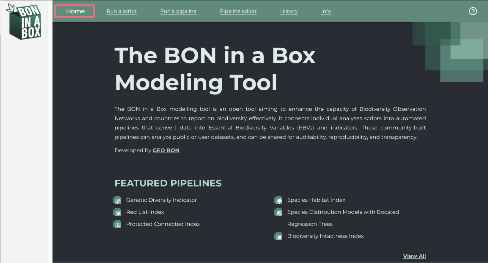
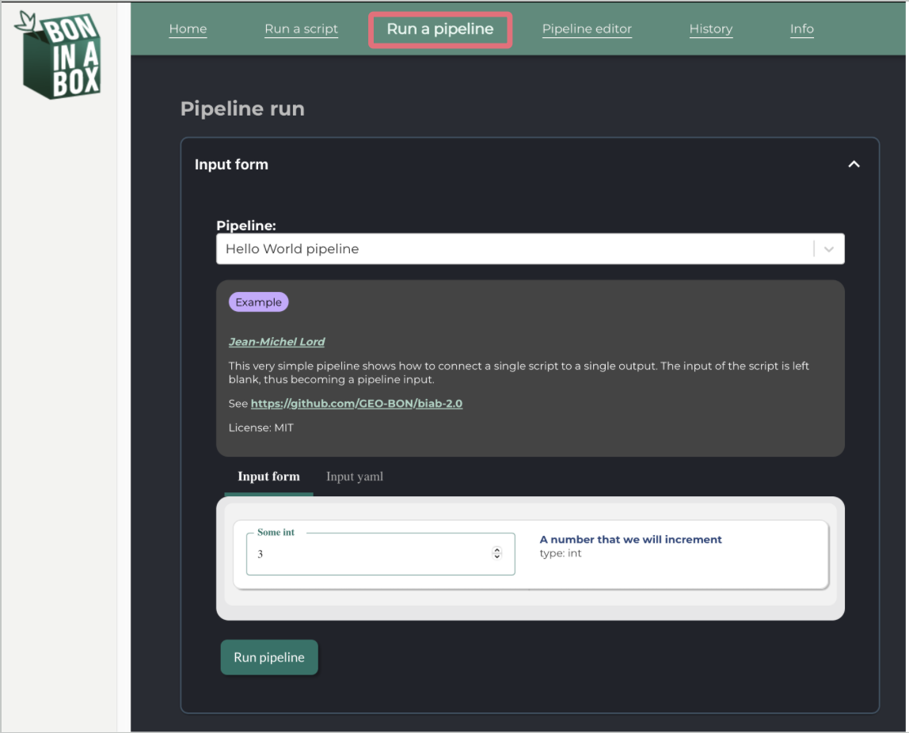
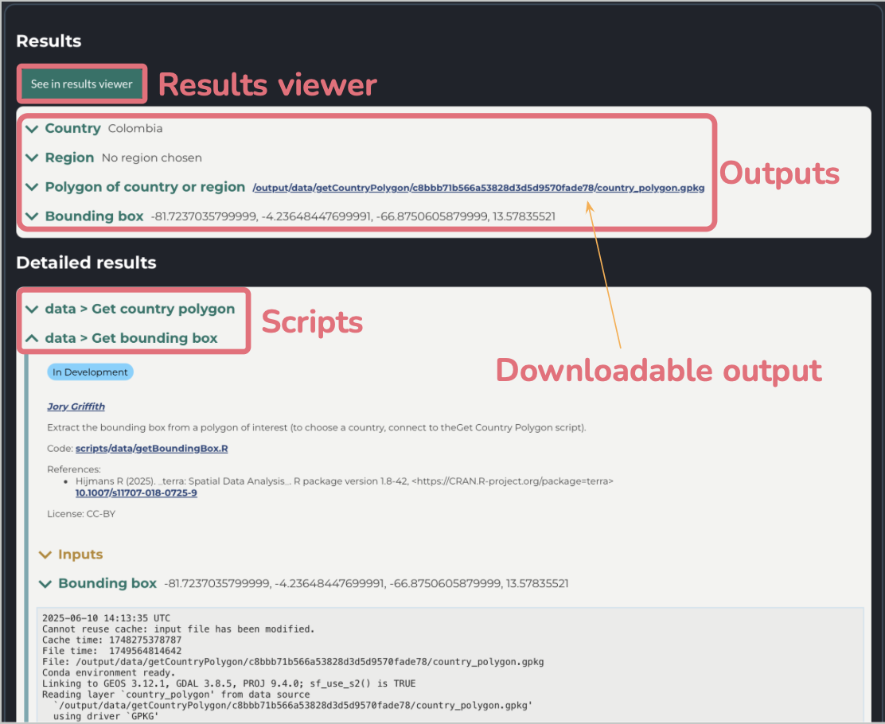
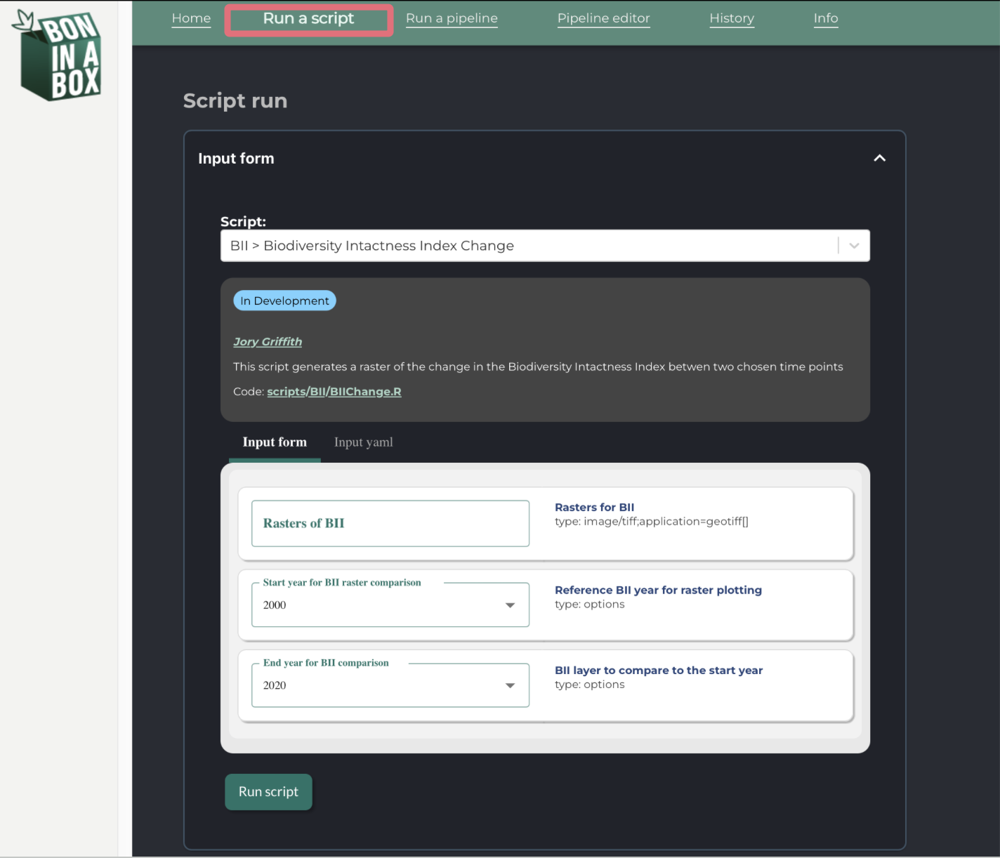
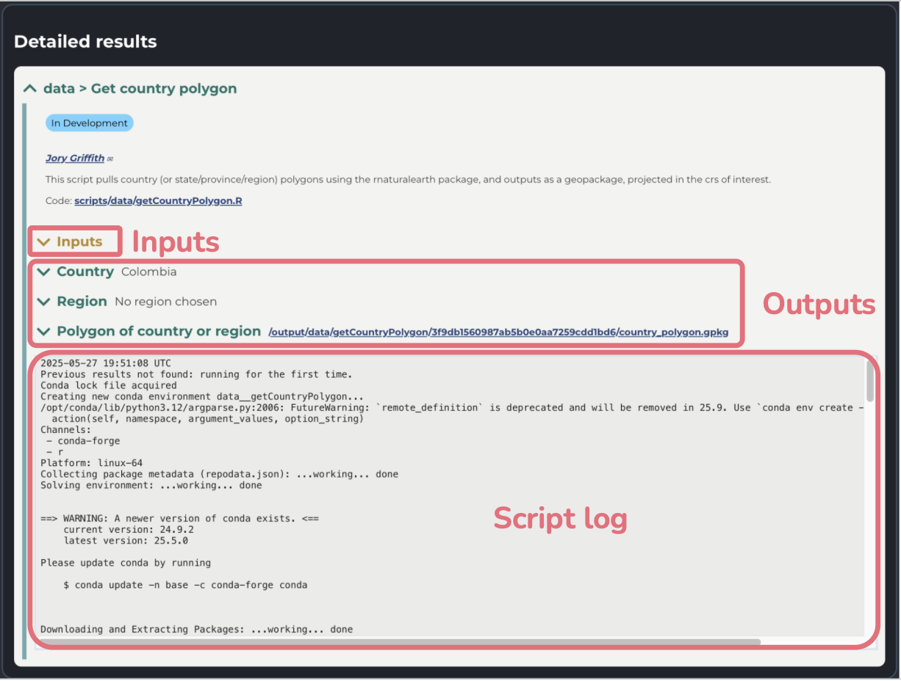
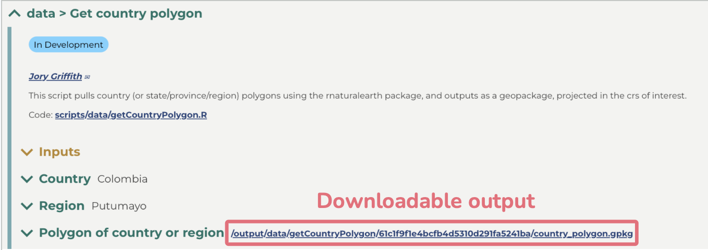
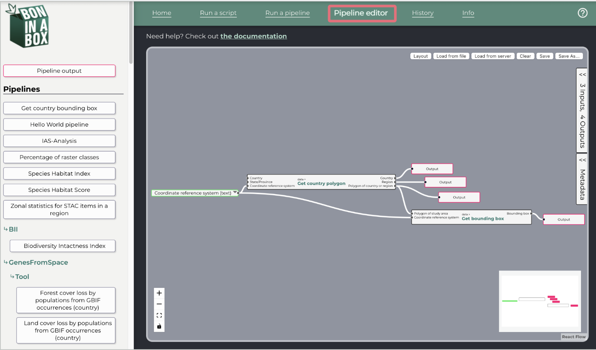
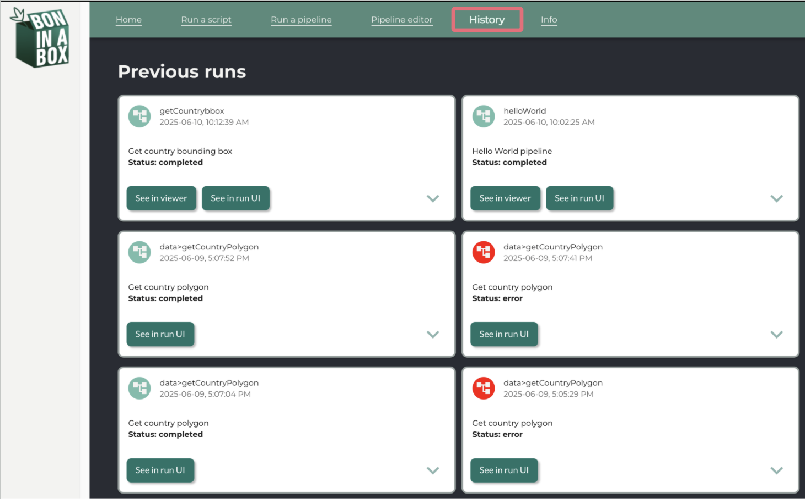
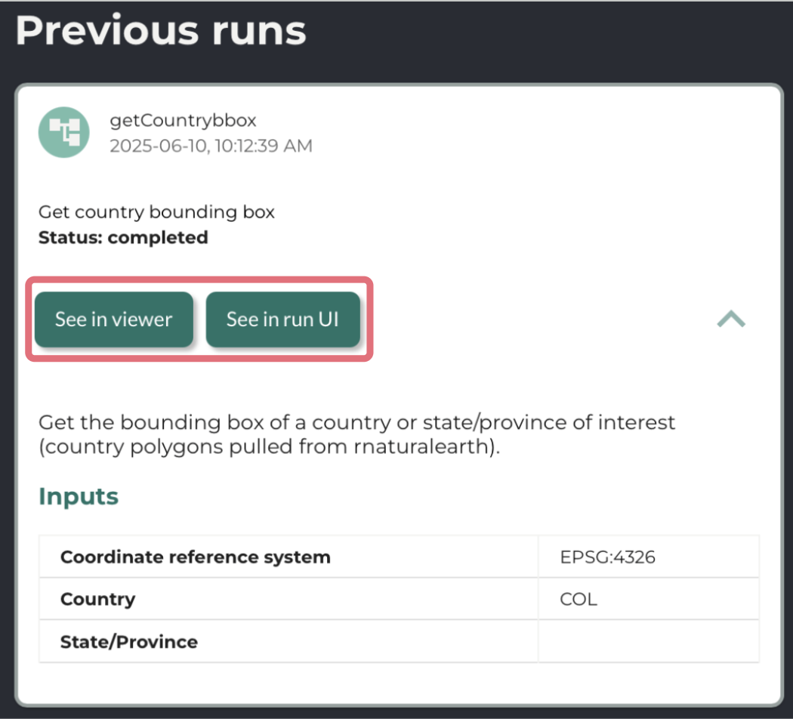

The Biodiversity Evaluation Engine (BEE) can be accessed directly through our online platform or installed locally on your computer.

For most users, **we recommend using the online platform**, which allows you to run biodiversity analysis pipelines and calculate Essential Biodiversity Variables (EBVs) and indicators without installing any software.

## Access BEE online (recommended)

BEE is available through a web-based interface, making biodiversity analysis accessible without requiring programming experience or local installation.

To get started:

1.  **Create a GEO BON account:** Register for free at [members.geobon.org](https://members.geobon.org/), if you are not already a member.

2.  **Request access to BEE:** Contact the BON in a Box team at [boninabox\@geobon.org](mailto:boninabox@geobon.org) to have your account approved.

3.  **Log in to BEE:** Once your account has been approved, access the platform at [auth.bee.geobon.org](https://auth.bee.geobon.org/).

Once logged in, you can explore available pipelines, provide your own input data, run analyses, and download results directly through your browser.

The sections below provide a step-by-step guide to using BEE.

## Running BEE locally (optional)

For most users, installing BEE locally is not necessary. However, a local installation may be useful if you:

- **Want to contribute to BEE:** Develop, test, or modify analytical pipelines and scripts, or contribute to the platform's development.

- **Have data privacy or security requirements:** Run analyses within your own computing environment rather than uploading potentially sensitive data to the online platform.

- **Need greater control over your computing environment:** Configure or manage your own installation for specific technical or institutional requirements.

To install BEE locally, follow our [installation instructions](https://geo-bon.github.io/bon-in-a-box-pipeline-engine/how_to_install.html).

Once installed:

1.  Start the services by running `./server-up.sh` in a Linux-compatible terminal (e.g., Git Bash or WSL on Windows, or Terminal on macOS). Make sure you are in the appropriate BON in a Box directory.

2.  Open a web browser and navigate to `http://localhost/`.

You can then use the same interface described in the User Guide below.

# User Guide

Here is a detailed guide on how to run analyses in BEE. This guide outlines the features of BEE and how to use them.

## Home

Under the `Home` tab, you will find a description of the BON in a Box Biodiversity Evaluation Engine, as well as its featured pipelines. And your most recent pipeline runs.

::: {style="margin-top: 40px;"}
:::

::: {style="margin-top: 40px;"}
:::

## Run a pipeline

The `Run a pipeline` tab can be used to run an entire pipeline to calculate an indicator or EBV. Pipelines run a full sequence of connected scripts and are designed to carry out a full analysis from start to finish. Each pipeline integrates multiple steps like pulling data, cleaning data, performing analyses, and plotting and formatting outputs into one automated workflow.

::: {style="margin-top: 40px;"}
:::

::: {style="margin-top: 40px;"}
:::

1.  Select from the drop down menu the pipeline you would like to run.

    - Once the pipeline is selected, there will be a description of the pipeline, with its authors and references.
    - Each pipeline will have a tag indicating whether it is still being developed, in review, or peer reviewed.

2.  Fill out the form with the input parameters the pipeline should use.

    - The pipeline will run with the default parameters, so you can run the pipeline right away to see what the outputs should look like.

    - Some inputs can be typed in, while others are in a drop down menu.

    - Each input field includes a description and its purpose on the right of the input box. Here you will also see the *type* of the input.

    - **Please ensure each input matches the required type that is specified in the input description.** The input will either be a primitive type (i.e. text, int, float, boolean, etc.) which the user will type in or a MIME type representing a file (e.g. text/csv, application/geo+json, etc.) where the user will provide the path to that file. To input a list, for example a list of species, seperate each item by a comma. **For more details on input types, please refer to "Step 3: Create a YAML File" in [the contribution guidelines](how_to_contribute.qmd).**

    - The form might ask you for a file. In order to provide a file that you have locally on your computer, first upload or copy it to the `userdata` folder using the `My Files` file manager. You can find it in the left sidebar of the application. Uploading files should be done prior to the analysis. Then, click on the file selection icon to see a list of available files. Once selected, it will be referred with a file path as such: `/userdata/myFile.shp`, or `/userdata/myFolder/myFile.shp` if there are subfolders. Most pipelines can also accept remote files (https://). That will be specified in the input documentation.

    - The `Input yaml` tab can be used to see how your inputs are being passed in to the pipeline. This is useful for sharing pipeline inputs for recreating results, as it can be copied and pasted to fill the input form. By scrolling down, you can also see how the inputs were defined by the author(s).

3.  Click on `Run pipeline`. If the pipeline or any of its steps has previously been run with the exact same inputs and the code has not changed, the existing results will be loaded.
4.  To terminate the execution of the script at any point, use the `Stop` button. 

After the script runs, you'll see a detailed `Results` box, which includes drop down arrows to view your inputs and script outputs. To simply view your output, click on the blue name or arrow. A gray box containing the logs of each individual script can be found under the outputs, where you can monitor the progress of the script. The logs also help with any debugging problems that occurred.

You can view the results using the drop down menu for each, or use `See in results viewer` for a more detailed and user-friendly (less technical) view of the outputs. Outputs can be downloaded by using the blue link next to the output name.

In the `Detailed results` you will find all the individual scripts used throughout the pipeline, as well as their inputs and outputs, their logs, and details about their runtime environment.

::: {style="margin-top: 40px;"}
:::

::: {style="margin-top: 40px;"}
:::

## Run a script

The `Run a script` tab lets you run an individual script and works very similarly to the `Run a pipeline` tab. Scripts are individual parts of pipelines designed to perform one well-defined task at a time, like extracting data from a file, cleaning files, or applying a specific formulas.

The `Run a script` functionality is normally used for testing individual components of a pipeline rather than producing usable outputs. Additionally, unlike pipelines, scripts often require inputs that are produced by other scripts, and so they may not run successfully with the default parameters. However, running a script can be useful for development, bug fixing, or trying to understand the purpose and outputs of a given step.

::: {style="margin-top: 40px;"}
:::

::: {style="margin-top: 40px;"}
:::

Simply fill out the desired inputs and click on `Run script`. To terminate the execution of the pipeline at any point, use the `stop` button. While the pipeline is running, you may see its progress under `Results`.

Individual scripts sometimes rely on files that are output by other scripts, and therefore may not run with default parameters. You may need to input files from the "userdata" folder or files downloaded from the outputs of other scripts to make the scripts run.

After the script runs, you'll see a detailed `Results` box, which includes drop down arrows to view your inputs and script outputs. To view an output, unfold the section or click on the blue link to download it. A gray box containing the script logs can be found under the outputs, which can help with debugging problems that occurred.

::: {style="margin-top: 40px;"}
:::

::: {style="margin-top: 40px;"}
:::

To download outputs, simply click the link next the output name.

::: {style="margin-top: 40px;"}
:::

::: {style="margin-top: 40px;"}
:::

If you see a red exclamation mark, the script failed to completely execute and an error message will be displayed. If you encounter an error due to the script’s internal structure (i.e. not a problem with your input parameters), please contact us on [Discourse](https://discourse.geobon.org) or email us at boninabox\@geobon.org. To try runing the script again, click `Run script` in the input form.

## Pipeline editor

Under the `Pipeline editor` tab, users can create and edit pipelines. For more information on how to do so, please refer to Step 6 "Connect your scripts with the BON in a Box pipeline editor" of the [how to contribute](how_to_contribute.qmd#pipeline_editor) page.

::: {style="margin-top: 40px;"}
:::

::: {style="margin-top: 40px;"}
:::

## History

The `History` tab shows previous script and pipeline runs.

::: {style="margin-top: 40px;"}
:::

::: {style="margin-top: 40px;"}
:::

Use the drop down arrow to see the inputs of a run and `See in run UI` to view the details of a run, including the inputs, outputs, and logs. The latter can be used to try the run again with some or all of the same inputs. For pipelines, you may see outputs in the results viewer using `See in viewer`.

If you run the same pipeline with the same input parameters multiple times, it will only show once in the history view.

::: {style="margin-top: 40px;"}
:::

::: {style="margin-top: 40px;"}
:::

**For any further questions, post an issue on [GitHub](https://github.com/GEO-BON/bon-in-a-box-pipelines), contact us on [Discourse](https://discourse.geobon.org) or email us at boninabox\@geobon.org.**