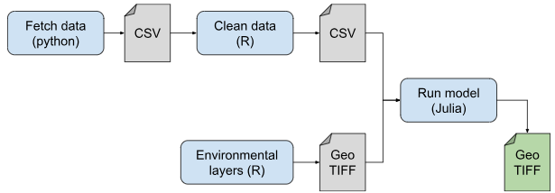

BON in a Box is an initiative of the Group on Earth Observations Biodiversity Observation Network (GEO BON) that brings together scientific expertise, tools, and biodiversity analysis to support biodiversity monitoring and reporting.

The platform provides resources for developing Biodiversity Observation Networks (BONs), a catalogue of biodiversity monitoring projects and tools, and the Biodiversity Evaluation Engine (BEE), which enables users to calculate Essential Biodiversity Variables (EBVs) and biodiversity indicators.

*For more information about BON in a Box in general, please refer to [BON in a Box's website](https://boninabox.geobon.org/about)*. *For more details on the rationale supporting the pipeline engine, refer to our [BioScience publication](https://doi.org/10.1093/biosci/biaf189 "BON in a Box: An Open and Collaborative Platform for Biodiversity Monitoring, Indicator Calculation, and Reporting").*

# What is BON in a Box's Biodiversity Evaluation Engine (BEE)?

The Biodiversity Evaluation Engine (BEE) is an open-source platform that brings together biodiversity data and scientific methods to calculate EBVs and indicators for biodiversity monitoring, conservation planning, and reporting.

BEE makes scientific analyses more accessible by allowing users to run standardized and reproducible analytical workflows, known as *pipelines*, without needing to develop the underlying code themselves.

Developed through contributions by the GEO BON scientific community, BEE integrates scientific expertise and methods from researchers around the world, enabling users to:

- **Calculate biodiversity indicators and EBVs** using scientifically robust and transparent methods.

- **Integrate diverse data sources**, including local biodiversity observations, global datasets, and Earth observation data.

- **Run reproducible analyses** through standardized workflows that can be applied across different geographical areas and contexts.

- **Access and contribute scientific methods** through an open-source, community-driven platform.

BEE supports biodiversity monitoring at local, national, and global scales, including the calculation of indicators relevant to the Kunming–Montreal Global Biodiversity Framework (GBF).

# Why do we need this platform?

Scientists around the world are developing tools to create workflows to calculate essential biodiversity variables and indicators to report on biodiversity change. However, there are almost no platforms to share these workflows and tools, leading to duplication of effort. BON in a Box allows networks to share and enhance each other's work.

At the same time, countries and organizations responsible for biodiversity monitoring and reporting may lack the technical resources or expertise needed to implement these methods.

**BEE aims to bridge the gap between scientific research and its practical application in biodiversity monitoring and decision-making.**

By bringing together analytical methods in a shared, open-source platform, BEE reduces duplication of effort, promotes scientific collaboration, and makes biodiversity analyses more accessible to a broader range of users.

# From biodiversity data to decision making

BEE connects biodiversity data with scientific methods to generate outputs that can inform conservation planning, biodiversity monitoring, and reporting.

Users can combine their own data with publicly available datasets, including species occurrences, protected areas, environmental variables, and Earth observation products.

These data are processed through analytical pipelines to produce outputs such as species distribution maps, connectivity metrics, EBVs, and biodiversity indicators.

By providing transparent and reproducible methods, BEE supports consistent biodiversity assessments across regions and over time, while allowing users to incorporate data and information relevant to their local context.

# What is a pipeline?

A pipeline is a sequence of analytical steps that transforms input data into meaningful outputs for biodiversity monitoring and decision-making.

Each pipeline brings together smaller, reusable components called *scripts*, which perform specific tasks such as downloading data, cleaning observations, running statistical models, or generating spatial outputs.

These scripts can be combined and reused across different pipelines, making it easier to develop new analyses and adapt existing methods.

If a pipeline builds upon the results of another pipeline, this "inner pipeline" can be included as a step in the "outer pipeline"; we call this a subpipeline. An SDM pipeline could serve to generate range maps inside a Species Habitat Index pipeline, or embedded in a Species Richness pipeline. We can thus define a step as "a script or a subpipeline performing an operation in the context of a pipeline".

BEE supports workflows developed in multiple programming languages, including R, Python, and Julia, allowing methods from different scientific communities to be integrated into a common analytical framework.

# Why should you contribute?

BON in a Box is built on collaboration across the global biodiversity research and monitoring community.

Researchers and developers can contribute analytical pipelines, scientific methods, and improvements to existing workflows, helping make their research accessible and applicable beyond its original context.

Contributing to BEE can help:

- **Increase the impact of research** by making scientific methods available for biodiversity monitoring and conservation decision-making.

- **Promote reproducibility and transparency** through open-source, documented workflows.

- **Support collaboration** by allowing researchers to build on and improve existing methods.

- **Strengthen biodiversity monitoring capacity** by making analytical tools more accessible to organizations and countries.

Contributed pipelines follow documented quality standards, with peer review supporting the scientific robustness, usability, and generalizability of published workflows.

To learn more, see our [contribution guidelines](https://geo-bon.github.io/bon-in-a-box-pipeline-engine/pipeline_standards.html) and [peer-review process](https://geo-bon.github.io/bon-in-a-box-pipeline-engine/peer_review.html).

# How to cite

Please cite the BON in a Box platform as:

Jory Griffith, Jean-Michel Lord, Michael D Catchen, Maria Isabel Arce-Plata, F Guillaume Blanchet, Mathusan Chandramohan, M Camila Diaz-Corzo, Dominique Gravel, César Gutiérrez, Isabelle S Helfenstein, Sean Hoban, Jamie M Kass, Linda Laikre, Guillaume Larocque, Deborah M Leigh, Brian Leung, Alicia Mastretta-Yanes, Katie L Millette, Maria Alejandra Molina Berbeo, Dat Nguyen, Kari E Norman, María Helena Olaya-Rodríguez, Simon Pahls, Kaitlyn Pereira, Pedro R Peres-Neto, Timothée Poisot, Laura J Pollock, Juan Carlos Rey-Velasco, Victor J Rincon-Parra, Claudia Roeoesli, François Rousseu, Lina María Sánchez-Clavijo, Meredith C Schuman, Oliver Selmoni, Jessica M da Silva, Erika Suarez-Valencia, Thilina D Surasinghe, Eren Turak, Luis Fernando Urbina, Sarah Valentin, Noah Wightman, Juan Zuloaga, Maria Cecilia Londoño, Andrew Gonzalez, BON in a Box: An Open and Collaborative Platform for Biodiversity Monitoring, Indicator Calculation, and Reporting, BioScience, 2026, biaf189, https://doi.org/10.1093/biosci/biaf189

Where applicable, users should also cite the individual analytical pipeline and its associated scientific methodology.